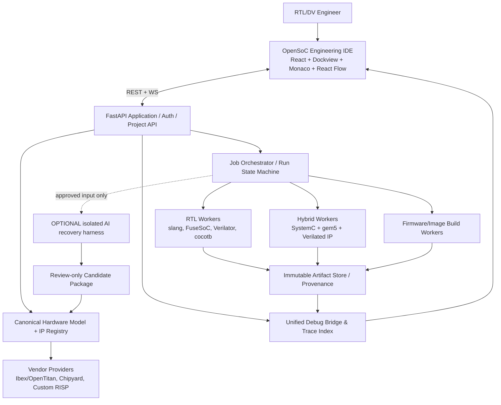

# OPENSOC STUDIO — ENGINEERING ARCHITECTURE & IMPLEMENTATION BLUEPRINT

**Document ID:** OSS-ARCH-001  
**Version:** 1.0 / Architecture Baseline  
**Date:** 2026-10-22  
**Audience:** Claude Code; Principal SoC Architect; RTL/DV Engineers; Full-stack EDA Engineers; Release/Compliance Owners  
**Status:** Normative design proposal. Upstream compatibility and dependencies require pinned-version verification before implementation.  
**Language:** Vietnamese (normative API/schema identifiers in English).

> **Sứ mệnh:** Xây dựng một **100% open-source software, GUI-first, RTL-first SoC Engineering Workbench**. Kỹ sư RTL/DV có thể import RTL, nhận diện hierarchy/interface, đóng gói thành IP library tái sử dụng, cấu hình CPU/bus/memory, nạp firmware, mô phỏng, xem waveform/transactions và debug theo tín hiệu/cycle ngay trong UI. Không bắt buộc người dùng biết SystemC. AI harness là extension tùy chọn cho legacy RTL recovery; simulator và việc phán quyết kết quả không phụ thuộc AI.

---

## 0. HƯỚNG DẪN DÙNG TÀI LIỆU NÀY CHO CLAUDE

Tài liệu này là **engineering contract**, không phải lời mời Claude sinh toàn bộ code một lượt. Claude PHẢI:

1. Kiểm tra repository hiện hữu, đánh giá các module có thể reuse; không xóa hoặc thay cấu trúc đã có nếu chưa chứng minh cần thiết.
2. Ghi lại upstream versions, APIs, license, system prerequisites, phần chưa kiểm chứng trong `docs/decisions/` và `docs/compliance/`.
3. Làm các **feasibility spikes** ở §19 trước khi khóa những lời hứa về gem5 hybrid, CPU và viewer.
4. Thiết kế theo contracts ở §§7–14; các interfaces/schema public phải có version và test.
5. Chỉ triển khai **một milestone** tại một thời điểm theo §20, có test và traceable evidence.
6. Tự chạy build/test nếu môi trường cho phép; nếu không, báo `NOT_EXECUTED` và đưa chính xác lệnh + lý do chặn. Không bao giờ ghi `PASS` khi chưa chạy.
7. Không dùng mock thay RTL/gem5 rồi quảng cáo là mô phỏng phần cứng thật.
8. Nếu yêu cầu mâu thuẫn, ưu tiên: **an toàn & license > semantic correctness > reproducibility > UI usefulness > performance > aesthetics**.
9. Mọi đề xuất API/CLI trong tài liệu là **target contract**, không phải API chắc chắn tồn tại ở upstream.
10. Quy trình thay đổi kiến trúc: ghi ADR, đánh giá migration, có test backward-compatibility và approval trước khi sửa contract.

**Definition of READY:** *Upstream verified + documented contract + executable proof + test evidence + license gate.*

## 1. PRODUCT REQUIREMENTS & NON-GOALS

### 1.1 Persona chính

- **RTL designer:** import Verilog/SystemVerilog; xem hierarchy, ports, clock/reset, source, schematic, waveforms; chạy smoke test.
- **DV engineer:** dùng lại testbench, assertion/reference, regression; debug bus handshake, register state, interrupts và CPU↔RTL transactions.
- **SoC integrator:** chọn vendor CPU/IP, đặt memory map, bridge, clock domain, boot source, firmware, chạy topology validator.
- **Architect:** so sánh bản thiết kế/CPU/config, giữ fidelity metadata, thử nhiều workloads.
- **Infrastructure maintainer:** quản lý worker, source/provenance, giấy phép, quyền truy cập, tài nguyên và audit log.

### 1.2 Tác vụ người dùng bắt buộc

`Create project → Import RTL → Analyze → Review inferred contracts → Publish IP → Assemble SoC → Select simulation lane → Attach firmware/scenario → Run → Debug in UI → Export reproducible evidence`.

### 1.3 Bất biến kiến trúc (MUST)

- 100% **software dependency được phân phối** phải là open-source hợp lệ; chỉ import RTL proprietary của người dùng nếu quyền sử dụng cho phép, trong storage riêng, không bundle làm dependency.
- Không yêu cầu license EDA trả tiền, API AI cloud, phần mềm commercial để chạy flows cơ sở.
- Core simulation chạy được khi **AI disabled, network disconnected**.
- User **không cần** lập trình SystemC; generated adapters/bridge do backend quản lý.
- Mọi CPU/RTL backend khai báo `SUPPORTED | EXPERIMENTAL | UNSUPPORTED`, có lý do; không hiện option như thể dùng được khi thiếu board/runtime.
- Không được coi gem5 general CPU model là exact RTL Rocket/Ibex/BOOM/CVA6.
- Trace thời gian simulation có đơn vị/chủ sở hữu/epoch rõ ràng; không dùng timestamp nhận WebSocket để đo latency.
- Sơ đồ SoC là **editor trên model chuẩn**, không phải ảnh trang trí; cập nhật phải validate và commit thành SoC configuration.
- Schematic/waveform/source/transaction synchronized bằng **explicit mapping**, không đoán theo chuỗi tên đơn giản.
- IP package có nguồn gốc/giấy phép/trạng thái kiểm chứng; vendor identity phải được chứng minh.
- Không tự sửa RTL gốc trong auto import/recovery; mọi artifact sinh vào workspace riêng.

### 1.4 Non-goals v1.0

Không cố thay thế sign-off EDA, full UVM commercial simulator, formal sign-off, power/physical sign-off; không bảo đảm nhập **arbitrary RTL** chạy tự động; không tự động hóa proprietary Claude web UI; không hứa multi-simulator checkpoint/state migration; không yêu cầu runtime hot-swap RTL↔TLM. Chức năng còn thiếu phải hiển thị trong UI, không làm giả.

## 2. INDUSTRY STUDY → DESIGN DECISIONS

| Nguồn tham chiếu | Học cái gì | Cách dùng | Không được nhầm |
|---|---|---|---|
| FuseSoC / Edalize | CAPI2 core fileset/targets/dependency/tool launch | Native adapter + package export | Không thay platform semantic model bằng CAPI2 |
| Chipyard | Chisel generator/configs, TileLink, CPU platform | Vendor provider, preserve upstream flow | Chipyard không phải một CPU core duy nhất |
| OpenTitan / Ibex | HJSON, topgen/regtool, TL-UL, security IP | Vendor provider + reference RTL platform | Ibex Simple System khác OpenTitan complete SoC |
| gem5 | CPU/cache/memory models, TLM bridge | Optional architecture/hybrid lane | CPU gem5 ≠ RTL microarchitecture fidelity |
| Verilator | Compile RTL, SystemC wrapper, tracing | Baseline RTL simulator | Không support mọi SV/UVM feature |
| SystemC/TLM | Deterministic co-simulation integration | Runtime behind UI | User không cần tự viết SystemC |
| SiliconCompiler | DAG, reproducibility, remote jobs | Future orchestration inspiration | Không copy cả stack nếu chưa cần |
| Kactus2 / commercial IP managers | IP-XACT cataloging & reuse UX | Reference design only; license review | Không sao chép code copyleft để tránh nghĩa vụ |
| React Flow / GLSP | Graph editor, typed actions | React Flow mặc định; GLSP optional | Graph không được là dữ liệu thật duy nhất |
| ROHD Schematic / Wave | Signal visualization & cross-probe | Experimental embedded candidate | Wave viewer repository còn ghi work-in-progress |
| Wellen | VCD/FST/GHW reading, Rust | Stable file-reading backend candidate | Không tự tạo renderer chỉ từ parser |
| Dockview | IDE docking, layout persistence | MIT core only | Tuyệt đối không lấy `dockview-enterprise` |
| OpenHands Agent SDK | Agent workspace/tool/harness | Optional isolated AI service | SDK MIT ≠ model weights được open-source |

**Architecture decision ADR-001:** Chọn **React + TypeScript + Dockview OSS + Monaco + React Flow + ELK.js**, thay vì Theia ngay từ đầu. Lý do: dễ kiểm soát license, độ nặng & UX SoC-specific, ít rủi ro coupling. Theia/GLSP có thể lắp qua adapter về sau nếu chứng minh đáng đầu tư. `Dockview Enterprise` banned.

**ADR-002:** Tách `SchematicAdapter` và `WaveformAdapter` khỏi UI shell. Thử ROHD song song Wellen; không hard-lock vào viewer mới chưa maturity-tested.

**ADR-003:** Về CPU có **hai lane** và một hybrid profile, **không mặc định hai CPU chạy đồng thời**: RTL CPU board (Ibex/Rocket/...) và gem5 architecture CPU; hybrid là gem5 CPU điều khiển RTL peripherals qua SystemC/TLM. Chỉ dùng CPU RTL + gem5 cùng mô phỏng khi xây một co-simulation contract riêng và có bằng chứng; không cần cho MVP.

**ADR-004:** Core là **modular monolith** FastAPI + PostgreSQL/SQLite abstraction, job workers process-isolated, event stream; tránh microservice sprawl. Rust Waveform service và C++ SystemC runner là tiến trình chuyên dụng.

## 3. 100% OPEN-SOURCE SOFTWARE: POLICY & RELEASE GATE

### 3.1 Phân loại

- **PREFERRED:** MIT, BSD-2/3, ISC, Apache-2.0 — nếu version thực có giấy phép tương ứng.
- **CONDITIONAL:** LGPL, MPL, EPL, EUPL, GPL/AGPL. Các license này **vẫn là open-source** nhưng cần kiểm tra copyleft, attribution, linking, modification, distribution/hosting.
- **BLOCKED:** proprietary runtime/library; source-available không thỏa OSI; unidentified license; AI weights/model không xác minh được; `dockview-enterprise`.
- **SEPARATE DATA:** imported vendor RTL không tự động trở thành OpenSoC redistributed dependency. RBAC + rights metadata + explicit export permission.

### 3.2 License matrix (upstream indicative — pin/audit trước build)

| Component | Reported project license | Decision | Checks required |
|---|---|---|---|
| SystemC reference | Apache-2.0 (verify exact release LICENSE/NOTICE) | core | Third-party NOTICE |
| gem5 | BSD-3-Clause & other included licenses | backend | per-file/3rd-party/resource audit |
| Verilator | LGPL-3.0 **OR** Artistic-2.0 | backend | applicable terms, tool runtime, generated artifact |
| FuseSoC/Edalize | BSD-style (verify pin) | package/backend | full transitive deps |
| slang/pyslang | MIT | RTL parser | Python wheel binary notice |
| Yosys | ISC | netlist generation | `abc`/libs license |
| React Flow | MIT (verify pin) | SoC editor | package versions |
| Dockview OSS (`dockview-react`) | MIT | IDE shell | exclude `dockview-enterprise` |
| Wellen | BSD-3-Clause | waveform service | Rust transitive license |
| ROHD Schematic & Wave | BSD-3-Clause (repo-level; audit) | optional | embedded Flutter/assets, maturity |
| Ibex/OpenTitan | Apache-2.0 unless otherwise noted | upstream provider | module/submodule exceptions |
| Chipyard | BSD-3-Clause/Apache-2.0 reported | upstream provider | submodules, generators & tools |
| Theia | EPL-2.0 OR GPL-2.0 w/ Classpath Exception | reference/optional | careful legal review |
| GLSP | EPL-2.0 | reference/optional | legal review |
| PeakRDL CLI | LGPL-3.0 | external only if approved | plugin-specific license |
| SystemRDL compiler | MIT | CSR parser | audit transitive |
| OpenHands Software Agent SDK | MIT | optional agent | model/tool licenses separately |

**Không công bố “100% license-compliant” chỉ vì bảng trên.** Chỉ phát hành khi exact pinned version + transitive SBOM + NOTICE + packaging/distribution review đã qua.

### 3.3 Release blocking CI

- SPDX expression xác định cho toàn bộ dependency & artifact, kể cả Docker base image, fonts, icon packs, fixtures và firmware đi kèm.
- Syft hoặc tương đương tạo CycloneDX/SPDX SBOM; ScanCode/ORT hoặc custom policy cross-check.
- Reject unknown & proprietary, unresolved/copyleft-without-review.
- Generate `THIRD_PARTY_NOTICES.md`, `LICENSE_EXCEPTIONS.md`, signed release manifest, source references/hashes.
- AI model catalog dùng `license_id`, `weights_hash`, `source_url`, `data_boundary`; disable cloud by default.
- Release gate yêu cầu audit của bộ phận pháp lý/compliance khi phát hành ra ngoài đơn vị.

## 4. HIGH-LEVEL ARCHITECTURE / TRUST BOUNDARIES



**Control plane**: UI/API/config/registry/run state. **Execution plane**: sandbox workers, native toolchains, simulators. **Data plane**: waveform index, events, artifacts, source maps. **Optional intelligence plane**: AI harness chỉ tạo proposals, không quyết định pass/fail.

### 4.1 Ranh giới công nghệ

- UI **không** shell exec hoặc đọc trực tiếp host filesystem. User import qua authorized project source/import API.
- API **không** chạy RTL simulation ở request thread; enqueue job, worker sở hữu process.
- Worker **không** ghi bừa ra nguồn RTL; input readonly, output content-addressed.
- Debug Bridge **không** sửa simulator; dùng artifacts/events instrumentation.
- Agent harness **không** được tự commit vào validated IP namespace.

## 5. FRONTEND LÀ ENGINEERING WORKBENCH (NOT DASHBOARD)

### 5.1 Workspace layout

- **Left rail:** project/source tree, IP library, CPU catalog, RTL hierarchy, signal browser.
- **Center main:** SoC Composer (graph) / RTL schematic / code editor / waveform canvas qua dockable tabs.
- **Right inspector:** selected IP, ports, address region, CSR fields, clock/reset, protocol obligations.
- **Bottom console:** build, run live log, assertions, transactions, firmware console, problems, performance.
- **Global:** command palette, run selector, current selected path/time, search, saved layouts, bookmarks, change history.

**Bắt buộc:** người dùng thay đổi mapping qua UI thì `SoCConfig` persisted; invalid edge/address không thể commit. UI báo error tại port, không chỉ popup.

### 5.2 Engineering workflows

**WF-UI-01** `Import RTL`: upload folder/archive/git reference → parameter/filelist → parse → top/module tree → review warnings → generate IP draft.

**WF-UI-02** `Package IP`: xác nhận supplier namespace/version, bus contract, registers, licenses, validation evidence → publish to registry → search/filter/reuse.

**WF-UI-03** `Compose SoC`: chọn CPU provider/profile → kéo IP từ catalog → chọn connection/bus adapter → đặt MMIO ranges → automatic address/clock validation → save topology.

**WF-UI-04** `Firmware`: attach ELF/VMEM + profile/ISA/entry/linker region → set load/boot strategy and stop conditions → reject incompatible image.

**WF-UI-05** `Run`: choose `rtl_standalone | rtl_cpu_soc | gem5_arch | gem5_hybrid` → scenario/testcases/fidelity → start/cancel → live logs → artifacts.

**WF-UI-06** `Deep Debug`: select hardware node → filter signal hierarchy → open exact wave file/run → jump to timestamp → inspect decoded transaction → locate RTL source / schematic net and owning register.

**WF-UI-07** `Regression`: compare runs by pinned artifact IDs, diff test verdicts, wave windows, transaction counts; export reproducible report.

### 5.3 Unified selection/event model — mandatory

Event bus frontend messages (typed, immutable, dedupe by `origin_id` to avoid cross-widget loops):

```typescript
export type WorkbenchSelection = {
  schemaVersion: '1.0';
  projectId: string;
  runId?: string;
  ipInstanceId?: string;       // Stable SoC instance ID
  hierarchyPath?: string;     // Elaborated RTL path, not display label
  signalId?: string;          // Stable trace index ID
  sourceLocation?: { fileId: string; line: number; column?: number };
  transactionId?: string;
  simTime?: { ticks: string; timescaleFs: string; domain?: string };
  originId: string;
  evidenceLevel: 'EXACT'|'DERIVED'|'UNAVAILABLE';
};
```

- SoC graph click → selection event → RTL hierarchy filter → waveform signal subset and transactions filtered by instance/address range.
- Transaction click → trace index ID → wave cursors/handshake signals → CSR inspector.
- Wave signal click → source-map resolve; nếu thiếu map, hiển thị `Mapping unavailable`, không đoán file/line.
- Cross-probing tests gồm flattened signals, generated wrappers, hierarchical renaming, optimized-away nets, no-wave dump.

### 5.4 Graph editor rules

- React Flow chỉ làm **view/controller**; canonical SoC model/server sở hữu data truth.
- ELK.js auto-layout sau topology diff, layout không thay connectivity semantics.
- Nodes typed: `cpu`, `memory`, `interconnect`, `bridge`, `peripheral`, `accelerator`, `interrupt_controller`, `clock/reset`.
- Edges typed: `TL-UL`, `TileLink`, `AXI4-Lite`, `AXI4`, `APB`, `generic_tlm`, `clock`, `reset`, `interrupt`.
- Edge validation: role `initiator/target`, width, protocol version, clock domain, address route, registered bridge; invalid edges blocked.
- Graph action produce audit-ready `SoCChangeSet`, backend validate then optimistic UI commit/rollback on conflict.
- Keyboard, zoom/fit, bus bundle grouping, minimap, editable memory map table, clear “unsaved changes” state.

### 5.5 Schematic + waveform engine strategy

- Parser/schematic source: elaboration via slang and optional **Yosys** netlist JSON. Source mapping optional, respect synthesis optimization.
- `SchematicAdapter`: thử ROHD Schematic Viewer (Flutter embedding as separate optional host/iframe with message protocol). Nếu integration thất bại thì dùng Yosys JSON + custom light schematic for MVP; không cần viết gate-level editor hoàn chỉnh.
- `WaveformBackend`: Rust + Wellen, lazy hierarchy/index & time-window fetching cho VCD/FST/GHW; raw waveform artifact luôn được giữ.
- `WaveformFrontend`: đánh giá ROHD Wave Viewer; benchmark loading, markers, cross-probing, JS/Flutter bridge. Có thể dùng panel riêng trong MVP; fallback external Surfer/GTKWave với path/logged invocation, nếu license cho phép.
- **Không dùng WaveDrom/WaveJSON** làm waveform debugger thực tế (chỉ docs/report).
- Wave transport: `signal groups + time-window samples`, không gửi toàn bộ VCD/FST qua WebSocket. HTTP range/binary frames khi cần.
- UI hỗ trợ X/Z/high-impedance/unknown như có trong format; không ép tất cả thành Boolean.

### 5.6 Suggested UX acceptance metrics (targets, NOT guarantees)

- Schematic graph pan/zoom mượt với thiết kế tham chiếu nhiều trăm IP/nodes; lazy expand nhiều ngàn.
- Hierarchy search với hàng chục ngàn tín hiệu không freeze main thread.
- Sau waveform index, thao tác xem cửa sổ vài ms đối với file FST nhiều GB không tải toàn file vào browser.
- Reconnect console từ `last_event_sequence` mà không mất log.
- State của workspace khôi phục giữa sessions; bookmarks thuộc `run_id`.
- Tập trung **debug correctness** hơn FPS benchmark tùy ý.

## 6. CPU/VENDOR PLATFORM ARCHITECTURE

### 6.1 CPU không phải dropdown hardcode

`CPUProvider` gói `supplier/source/generator/toolchain/ISA/XLEN/privileged_ext/bus/interrupt/clock/boot/model_views/tests/license/source_pins`. CPU profile không chỉ là model name; là một compatibility contract.

**Priority P0:**
- **Ibex (lowRISC/OpenTitan):** SystemVerilog RV32, reuse official FuseSoC + `ibex_simple_system` and/or `ibex_demo_system`, known-good bare-metal firmware; use existing Verilator support as acceptance anchor.
- **Rocket (Chipyard):** Chisel/Generator profile; build output snapshot + configuration/hash; respect TileLink/Chipyard native glue; preserve vendor build logic.

**P1:** CVA6, BOOM, internal RISP/control host (nếu có và đủ spec). **P2:** Shuttle, VexiiRiscv, VeeR/CV32E40P. All are provider-specific and not assumed Verilator-ready.

**Known compatibility caveat:** Chipyard documentation warns certain CVA6 Chipyard targets are not supported under Verilator, so they must be `UNSUPPORTED` for that version/profile until independently proven with an OSS-only flow.

### 6.2 CPU lanes

| Lane | CPU actually running | Devices | Credible output | Not to claim |
|---|---|---|---|---|
| `rtl_standalone` | none | individual RTL IP | signals, protocol, test vectors | CPU or SoC performance |
| `rtl_cpu_soc` | actual Ibex/Rocket/etc RTL | RTL + selected models | RTL cycles, functional execution | silicon PPA |
| `gem5_arch` | gem5 CPU model | gem5 devices / behavioral models | architectural experiment statistics | exact vendor-core cycles |
| `gem5_hybrid` | gem5 CPU model | Verilated RTL IP via SystemC/TLM | MMIO software-hardware integration | vendor RTL CPU performance |

A lane selection sets **fidelity assumptions** in report + UI; same workload across lanes is comparable only after explicitly checking ISA, memory map, input equivalence and metrics units.

### 6.3 Vendor adapters

**OpenTitanProvider:** Import native HJSON metadata, `regtool`/`topgen`/`ipgen`/`tlgen` outputs, TL-UL bus and CSR if supplied; never rewrite upstream generator. Distinguish a full OpenTitan top from extracting a standalone IP. Need review crossbar/interrupt/reset.

**ChipyardProvider:** Record pinned Chipyard commit + submodule hashes + Chisel config class + FIRRTL/circt/generated RTL hash; integrate compile/elaboration through official flow. Do not infer CPU bus only from public top port names.

**InternalProvider:** custom RISP/accelerator or company IP managed in private namespace with explicit rights metadata; never label internal IP as an external vendor product without provenance.

### 6.4 Provider contract

```python
from typing import Protocol

class CPUProvider(Protocol):
    def discover(self) -> list[dict]: ...
    def validate_profile(self, profile: dict) -> dict: ...
    def resolve_sources(self, profile: dict) -> dict: ...
    def build(self, profile: dict, workspace: str) -> dict: ...
    def boot_contract(self, profile: dict) -> dict: ...
    def supported_lanes(self, profile: dict) -> list[str]: ...
    def license_manifest(self, profile: dict) -> dict: ...
```

Implement as typed/dataclass/pydantic models in real repository, not raw dicts: above is explanatory interface only.

## 7. CANONICAL HARDWARE MODEL (CHM) & IP REGISTRY

### 7.1 Không lấy format bên ngoài làm database source of truth

CHM is versioned domain IR; importers from FuseSoC CAPI2, IP-XACT, OpenTitan HJSON, SystemRDL, RTL AST, Chipyard configs. Exporters only when semantics preserved; loss reports compulsory.

**Entities:** `Project`, `SourceRevision`, `IPDefinition`, `IPVersion`, `IPView`, `Parameter`, `Port`, `BusInterface`, `RegisterBlock`, `Register`, `Field`, `ClockDomain`, `ResetDomain`, `Interrupt`, `FirmwareProfile`, `CPUProfile`, `SoCConfig`, `Instance`, `Connection`, `AddressRegion`, `Scenario`, `Run`, `Artifact`, `TraceSignal`, `TraceEvent`, `EvidenceRecord`, `LicenseRecord`.

**Identity:** `ip_id = namespace:library:name:semantic-version` (not SHA only); `content_hash` immutable; `source_repo+commit`, `generator_config_hash`, `interface_contract_revision`. Use dependency lock graph.

### 7.2 Knowledge provenance levels

- `EXTRACTED`: tool-derived from RTL/spec, with parser output pointer.
- `INFERRED`: heuristic/agent hypothesis, unverified.
- `REVIEWED`: human-provided mapping/semantics approved.
- `VERIFIED`: deterministic tests validate stated contract for specified version/config.
- `UNAVAILABLE`: absence acknowledged.

`VALIDATED` is always scoped to a particular contract / toolchain / scenario / evidence, never a universal IP claim.

### 7.3 Example IP package (target schema)

```yaml
schema_version: "1.0"
ip:
  id: "internal:crypto:aes128:1.0.0"
  display_name: "AES-128 accelerator"
  supplier: {kind: internal, name: internal}
  rights: {license_expression: "Proprietary-Internal", redistribution: forbidden}
  source:
    repository: "internal://crypto/aes"
    commit: "<pinned_sha>"
    fileset: ["rtl/aes_top.sv", "rtl/aes_core.sv"]
    top: "aes_top"
    content_sha256: "<hash>"
  interfaces:
    - id: "control"
      protocol: "AXI4-Lite"
      role: "slave"
      address_width: 16
      data_width: 32
      provenance: REVIEWED
      adapter_contract: "axi4lite_slave_v1"
  clocks: [{name: "aclk", frequency_hz: 100000000}]
  resets: [{name: "aresetn", active_low: true, asynchronous: false}]
  csr:
    base_offset: "0x0"
    source: "spec/registers.rdl"
    provenance: REVIEWED
  views:
    - {name: rtl, provider: verilator, status: VERIFIED}
    - {name: functional, provider: internal_model, status: UNAVAILABLE}
  validation:
    evidence_ids: ["ev-001", "ev-002"]
  license_audit: {status: REVIEW_REQUIRED}
```

**Example note:** proprietary imported RTL is user data, not a redistributed OSS dependency. For platform demo, use open-source RTL IP instead. `content_sha256` etc are placeholders; no fake hashes.

### 7.4 Reverse RTL → reusable vendor-style IP

`RTL sources → source list resolution → AST/elaboration → ports/parameters/hierarchy → protocol candidate matching → human/agent proposal → CSR/spec corroboration → packaging → lint/smoke/protocol tests → provenance/license audit → registry publish`.

Never assume CSR reset values, side effects (`W1C`,`RC`), address layout, interrupts, ordering or vendor identity can be exactly recovered from RTL alone. Use capability flags for missing information and review actions.

### 7.5 Registry services

Search by protocol, ISA, source vendor, license, tested simulator, clock, data width, register view, stable version; resolve dependency trees; promote `DRAFT → REVIEWED → VALIDATED → PUBLISHED`; regression invalidation on content/adapter/toolchain changes; incompatible versions cannot silently replace a running project dependency.

## 8. RTL IMPORT AND ADAPTER GENERATION

### 8.1 Deterministic import pipeline

1. Ingest Git snapshot/allowed upload folder/archive into immutable staging, sanitize paths.
2. Resolve filelist (`-f`), include dirs, defines, packages, modules, parameters, target top.
3. Use `slang/pyslang` for AST, diagnostics, hierarchy, candidate clock/reset and bus port classes; use Verilator as compile/lint + execution backend. Their ASTs are not guaranteed identical.
4. Match protocol templates from verified specs: AXI4-Lite first, APB later, TL-UL/TileLink specialized providers; AXI4 burst & DMA after protocol test.
5. Produce **reviewable contract** with detected/inferred/required properties; surface unresolved items in UI.
6. Generate wrapper/monitor from **versioned template**, not freeform text. Pin generator/template hash.
7. Compile in sandbox with explicit source list/tool version, run smoke and protocol tests.
8. Register result only after appropriate tests+rights gates pass.

### 8.2 Protocol capability levels

- `PIN_LEVEL`: explicit clk/reset ports, simulation-only; no MMIO claims.
- `REGISTER_MMIO`: test driver for small standard address/response protocol.
- `BUS_TRANSACTION`: AXI4-Lite/APB/TL-UL with correct handshake/error rules.
- `BUS_ADVANCED`: AXI4 bursts, IDs, ordering, DMA, coherency only after dedicated tests.
- `COHERENT_INTERCONNECT`: TileLink coherence or other protocols; do not use simple TLM Generic Payload as proof of equivalence.

### 8.3 Adapter contract (C++/SystemC side)

- Packet fields: address, command, data bytes, mask, size, response status, exclusive/atomic flags if supported, correlation ID, simulation time.
- Correct `ready/valid` sampling at clock edge; prevent duplicate transfers; independent AXI4-Lite AW and W channels; B/R response completion; backpressure; resets during inflight transactions; timeout policy.
- Endianness, alignment, byte strobes, access permissions, DMI policy, transaction lifetime.
- Clock/reset provenance and transition/interrupt timing clearly logged.
- Build `standalone adapter unit-test harness` **before** building gem5 bridge.

### 8.4 Definition of unsupported

If module needs DPI/vendor encrypted IP, proprietary primitive, unsupported SV construct, unknown proprietary protocol, undetermined memory map or unusual CDC: show actionable diagnostics and `UNSUPPORTED/NEEDS_REVIEW`. Never fabricate functional black-box data or auto mark PASS.

## 9. SOC COMPOSITION & MEMORY MAP

### 9.1 SoC model (example contract)

```yaml
schema_version: "1.0"
soc:
  id: crypto_soc
  lane: rtl_cpu_soc
  cpu:
    provider: lowrisc_ibex
    profile: simple_system_small
    revision: "<pinned-upstream-commit>"
  instances:
    - id: ram0
      ip: opensoc:memory:ram:1.0.0
      base: "0x00100000"
      size: "0x00100000"
    - id: aes0
      ip: internal:crypto:aes128:1.0.0
      base: "0x40000000"
      size: "0x00010000"
      bus_interface: control
  connections:
    - {from: "cpu0.data", to: "bus0.initiator", via: "ibex_mem_bridge_v1"}
    - {from: "bus0.target_aes", to: "aes0.control", via: "axi4lite_v1"}
  clocks:
    - {name: "core_clk", frequency_hz: 100000000}
  reset:
    sequence: ["assert", "initialize_memory", "deassert", "boot"]
```

**Illustrative only:** ports (`cpu0.data`) and bridge are not native known Ibex names. Must derive from a real validated reference board; do not implement example blind.

### 9.2 Validation

Use half-open address intervals `[base, base+size)`; detect overflow, overlap, holes per intended policy, alignment/width, bus/endian mismatch, unmapped interrupt destinations, duplicated target, clock/reset mismatch, missing boot region. Provide exact node/edge/error code in UI.

Config diffs require schema migration; generator flags stored in lockfile; no hardcoded system topology in C++ runner.

## 10. EXECUTION LANES & gem5/SYSTEMC/VERILATOR BRIDGE

### 10.1 RTL standalone

`RTL → FuseSoC/Edalize or native fileset → Verilator → compiled harness → test scenarios → VCD/FST + assertions + structured events`.

### 10.2 RTL CPU SoC lane

Use **Ibex official Simple System or Demo System** first to boot bare-metal firmware, record PC, cycle counters and MMIO. Extend with one simple peripheral through native bus adapter only after baseline passes. Subsequent Rocket/Chipyard support requires generator/TileLink-aware board and toolchain compatibility.

### 10.3 gem5 architecture lane

`RISC-V board profile + CPU/cache/memory + workload → gem5 stats`. Distinguish **SE** vs full-system/bare-metal board. MMIO hardware boot needs board/device/interrupt/physical addresses; cannot simply upload arbitrary ELF and assume full hardware semantics.

### 10.4 gem5 hybrid lane (HIGHEST TECHNICAL RISK)

`gem5 RISC-V CPU + memory system → gem5 External Port ↔ SystemC TLM transactor → verified TLM-to-pin AXI/APB/TL bridge → Verilated RTL peripheral → response to CPU`.

Review gem5 `util/tlm` and examples (`Gem5SimControl`, master/slave transactors). Verify **direction semantics**, build flags and version support experimentally; no copy-paste assumptions about “master” naming.

**Time contract:** select SystemC as orchestrating kernel if compatible with upstream demo; define resolution in femtoseconds and integer tick mapping (`gem5 ticks ↔ sc_time ↔ RTL clock cycles`). Define events before/after posedge, transaction begin/end, delta cycles, quantum/timing mode. Apply bounded progress/timeouts to detect deadlock. No uncontrolled wall-clock sleep for synchronization.

**Test bridge in stages:**
- P0: gem5 CPU/MMIO ↔ SystemC synthetic target (no RTL), read/write response correct.
- P1: SystemC generated bus transactor ↔ simple Verilated register block (no gem5).
- P2: complete gem5 ↔ TLM ↔ RTL read/write, with known firmware and byte enables.
- P3: interrupts, reset during transaction, backpressure, timeout, mixed widths.

Do **not** merge P0–P3 as one giant opaque debugging task. Gate gem5 hybrid roadmap on P0/P1 success.

## 11. FIRMWARE AND SCENARIO CONTRACT

### 11.1 Firmware validation

- Parse ELF header: architecture, class (ELF32/64), endianness, ABI, RISC-V extensions (where derivable), entry point, segments, memory ranges.
- Compare against board profile (`XLEN`, load address, boot path, memory map, exception/interrupt vectors, privilege mode).
- Real toolchain for firmware build separately audited (RISC-V GCC/LLVM options; license notices).
- VMEM/BIN generation output hash and load address specified.
- Reject incompatible firmware **before** simulation; UI shows conflict.

### 11.2 Scenario definition

```yaml
schema_version: "1.0"
scenario:
  id: aes_smoke
  board: crypto_soc
  lane: rtl_cpu_soc
  firmware:
    format: elf
    artifact_id: "artifact-elf-001"
    entry_policy: board_default
  stop:
    max_sim_time: "5ms"
    max_wall_time_s: 300
    pass_event: "firmware_exit:0"
  trace:
    format: fst
    signals: ["soc_top.aes0.*", "soc_top.bus0.*"]
  checks:
    - type: register_readback
      register: "aes0.STATUS"
      expected: "0x00000001"
      requires: verified_csr_map
```

`PASS` requires explicit oracle/reference/test event. Program exits successfully ≠ cryptographic computation is correct unless vector verified.

## 12. RUN ENGINE, QUEUE & REPRODUCIBILITY

### 12.1 Job state machine

`CREATED → VALIDATING → QUEUED → BUILDING → RUNNING → COLLECTING → VERIFYING → COMPLETED_PASS | COMPLETED_FAIL`; edges to `FAILED_INFRA`, `FAILED_BUILD`, `FAILED_RUN`, `TIMED_OUT`, `CANCELLED`, `BLOCKED` with reason codes. No illegal reverse transitions.

Distinguish `simulation crashed` vs `test verdict failed` vs `simulation completed without oracle` (`INCONCLUSIVE`). Track exit code and tool stderr separately.

### 12.2 Manifest-driven execution

`RunManifest` = schema version + project snapshot hash + IP version/sha + CPU source/generator cfg + board cfg + firmware hash + scenario/test + adapter hashes + simulator/toolchain image digest + seed + time resolution + trace config + permitted resources + license status.

Run records immutable. Queue execution from `RunManifest` only; reproducible and cacheable build artifacts keyed by hash; do not cache mutable workspace paths or secrets.

### 12.3 Local-first → team scale

- MVP: FastAPI modular monolith + SQLite + local single-worker + files under managed root (no arbitrary shell).
- Team: PostgreSQL + Redis/queue (after license audit) + shared S3-compatible OSS storage (license audit) + 1+ execution workers.
- Larger: worker pool categories `rtl_compile`, `rtl_sim`, `gem5_hybrid`, `wave_index`, `agent_recovery`; quotas/reservations.
- Scale horizontally **across independent runs**; a single gem5/SystemC coupled run cannot be assumed parallelizable.
- Use immutable job contracts so deployment topology can change without migrating business logic.

## 13. UNIFIED DEBUG EVENT CONTRACT

### 13.1 Trace schema

```json
{
  "schema_version": "1.0",
  "run_id": "run-0042",
  "event_id": "ev-8f28",
  "seq": 812,
  "event_kind": "MMIO_WRITE",
  "producer": "gem5_tlm_bridge",
  "sim_time": {"ticks": "1250000", "tick_fs": "1000", "origin": "simulation_zero"},
  "clock_domain": "periph_clk",
  "rtl_cycle": null,
  "instance_id": "aes0",
  "address": "0x40000000",
  "write_data": "0x00000001",
  "byte_enable": "0xf",
  "transaction_id": "txn-0092",
  "hierarchy_path": null,
  "source_ref": null,
  "correlation": {"kind": "INSTRUMENTED", "confidence": "EXACT"}
}
```

`rtl_cycle` nullable across domains; map cycles with domain-specific clock edge index when available. `ticks` string is intentional: integer precision beyond JS Number. Record start/end events and backpressure/latency observations; never compute latency from WallClock receive time.

### 13.2 Correlation sources

- **EXACT:** instrumented ID passed through bridge/transactor.
- **DERIVED:** bus decoder matches a transaction using address/time/handshake windows, reports ambiguity.
- **UNAVAILABLE:** insufficient dump or source mapping.

UI must differentiate these. Source mapping `RTL loc` from AST/netlist debug attributes; symbol presence not guaranteed after synthesis/optimization.

### 13.3 Waveform indexing API

`GET /runs/{id}/signals?prefix=...` hierarchy + metadata.  
`GET /runs/{id}/waveforms/{traceId}/window?start_ticks=...&end_ticks=...&signals=...` returns bounded binary/JSON encoding.  
`GET /runs/{id}/transactions?start_ticks=&end_ticks=&ip_instance=` uses paginated index.  
`GET /runs/{id}/debug/correlate?transaction_id=...` returns available source/wave/graph links and evidence.

Use Rust Wellen worker for robust index/read; enforce size limits, not all FST content loaded into web memory.

## 14. API, EVENT STREAM & ERROR CODES

### 14.1 Proposed REST API

```text
POST   /api/v1/projects
POST   /api/v1/projects/{id}/rtl-imports
GET    /api/v1/rtl-imports/{id}
POST   /api/v1/rtl-imports/{id}/analyze
POST   /api/v1/ip-packages/{id}/review
POST   /api/v1/ip-packages/{id}/publish
GET    /api/v1/ip-registry?query=&protocol=&license=&status=
GET    /api/v1/cpu-providers
GET    /api/v1/cpu-profiles/{id}/capabilities
POST   /api/v1/soc-configs
POST   /api/v1/soc-configs/{id}/validate
PATCH  /api/v1/soc-configs/{id}          # optimistic lock via ETag
POST   /api/v1/firmware/import
POST   /api/v1/scenarios
POST   /api/v1/runs
GET    /api/v1/runs/{id}
POST   /api/v1/runs/{id}/cancel
GET    /api/v1/runs/{id}/artifacts
GET    /api/v1/runs/{id}/events?after_seq=
WS     /api/v1/runs/{id}/stream?after_seq=
```

Error: `400 invalid syntax`, `401/403 access`, `409 revision conflict`, `422 contract invalid`, `424 unsupported dependency`, `429 quota`, `5xx infra`. Stable JSON error `{code,message,details,correlation_id}`.

### 14.2 WS events

`job.state`, `build.log`, `sim.log`, `trace.event`, `assertion`, `artifact.ready`, `run.verdict`, `warning`. Each event carries monotonically increasing per-run `seq`; reconnect replay from `after_seq`. A high rate of signal toggles belongs to waveform indexing, **not** WS JSON push for every edge.

### 14.3 Security & identity

All endpoints scoped to project and RBAC roles `viewer`, `engineer`, `maintainer`, `admin`. Audit changes to source, mappings, rights, run manifests and promotion of IP. Session CSRF rules for browser; WebSocket authorization and token expiry managed securely.

## 15. OPTIONAL AI AGENT HARNESS: IP RECOVERY ONLY

### 15.1 Trust model

AI service is opt-in by project policy. No AI in deterministic simulation, verdict calculation or protocol semantics validation. Default **OFF**, with provider policies: `NO_AI`, `LOCAL_APPROVED`, `CLOUD_APPROVED` (cloud only when organization explicitly allows source transfer).

AI use cases: legacy RTL interface hypothesis, missing documentation, suggested CSR descriptions, generated adapter candidate, test scaffolding, build-error triage, IP classification and provenance search. Never invent identity/license/verified behavior.

### 15.2 Agent contracts

`RecoveryTask` input = readonly source snapshot hash, permitted tools, privacy scope, contract schema, goals, attempt budget, provenance evidence. `RecoveryCandidate` output = changeset patch under isolated workspace, proposed `IPManifest`, source citations, unknowns, generated tests, tool logs; status `PROPOSED` (never `VERIFIED`).

**Harness lifecycle:** `REQUESTED → ANALYSIS → PROPOSED → COMPILE_TEST → HUMAN_REVIEW → ACCEPT/REJECT`; deterministic gates can refuse and make agent retry within budget. Tool access allowlist; no default Internet; no secrets; manual export approval.

### 15.3 Model provider separation

Use interface `AgentProvider` with `none/local/external`. OpenHands SDK (MIT reported) optional candidate, not mandatory runtime. Models accessed by local open-source-compatible inference engine, weights license per model. Calling proprietary Claude cloud/web is outside 100% OSS **software-runtime requirement** and cannot be mandatory; using Claude Code for development does not make Claude a runtime dependency.

**Data security:** Company/vendor IP must never leave local/on-prem infrastructure absent explicit written approval and review of cloud retention/terms/permissions.

## 16. SECURITY, SANDBOX & FAILURE ISOLATION

- Treat all imported RTL, archives, build scripts, DV testbenches and toolchains as **untrusted executable content**.
- Sandboxed worker as unprivileged user, no host Docker socket, no privileged container, readonly source mount, constrained output mount; resource quota (CPU/RAM/disk/walltime/pids), network disabled by default, allowlisted executables.
- Archive import guards: zip-slip, symlink escape, path traversal, archive bomb, case-insensitive collisions, absolute path.
- Hash all inputs, validate path/canonical roots, contain include directories, inspect embedded scripts.
- Encrypted/proprietary IP license restrictions enforced before worker staging; artifact access belongs to project RBAC.
- A crash/hung native simulator kills **only its worker**, never API/UI; run goes to terminal error state with reason and logs.
- Worker cancellation: signal process group, grace, force kill, mark partial trace artifact incomplete; no zombie processes.
- No network telemetry or outbound service required for the default installation.

## 17. REPOSITORY TOPOLOGY (TARGET)

```text
opensoc-studio/
├── README.md
├── LICENSE                       # project-owned code license subject to approval
├── AGENTS.md                     # Claude implementation rules
├── docs/
│   ├── architecture/             # ADR, C4, runtime, timing, UI
│   ├── contracts/                # CHM, CPU profiles, adapters, events
│   ├── compliance/               # license matrix, SPDX, notices
│   ├── reference-platforms/      # Ibex / Chipyard / OpenTitan / gem5
│   ├── ux/                       # user journeys, shortcuts, acceptance
│   └── test-evidence/
├── schemas/                       # JSON Schema / OpenAPI / event contracts
├── apps/
│   ├── web/                      # React + Dockview + Monaco + React Flow
│   └── api/                      # FastAPI modular monolith
├── packages/
│   ├── hardware-model/           # CHM + validators
│   ├── vendor-providers/         # Ibex, OpenTitan, Chipyard, internal
│   ├── ip-registry/              # versioning and dependencies
│   ├── soc-assembly/             # graph/memory/bus rules
│   ├── runtime-contracts/        # typed manifests and interfaces
│   ├── debug-bridge/             # identity/time/source correlation
│   └── ui-sdk/                   # pluggable workbench panels
├── workers/
│   ├── rtl/                      # slang, FuseSoC, Verilator, tests
│   ├── hybrid/                   # C++ SystemC TLM + gem5 co-sim
│   ├── firmware/
│   ├── waveform/                 # Rust Wellen
│   └── agent-optional/           # isolated AI candidate recovery
├── reference/
│   ├── axi4lite_register_ip/
│   ├── ibex_simple_system/
│   ├── opentitan_tlul_ip/
│   └── chipyard_rocket/
├── tests/
│   ├── schema/
│   ├── contract/
│   ├── integration/
│   ├── browser-e2e/
│   ├── simulator-e2e/
│   └── licensing/
├── infra/
│   ├── docker/
│   ├── devcontainer/
│   ├── worker-images/
│   └── scripts/
├── sbom/
└── .github/workflows/           # or internal OSS CI equivalent
```

**Rule:** APIs above compilers, providers and UI may import shared contracts, but `hardware-model` must never import `apps/web` or `vendor-providers` concrete classes. Prefer composition over deep inheritance.

## 18. TEST STRATEGY & EVIDENCE MATRIX

### 18.1 Testing pyramid

1. **Unit/schema:** address range overlap/overflow, protocol compatibility, CHM version migration, API validators, trace tick conversion, provenance.
2. **Contract:** each tool/vendor adapter against pinned sample and expected machine-readable output.
3. **Standalone simulator:** RTL register test with known vectors, reset/handshake/backpressure/partial writes.
4. **RTL CPU board:** official Ibex smoke firmware + added MMIO module; instruction and cycle traces visible.
5. **gem5 bridge:** gem5 memory mapped test via SystemC synthetic target, then Verilated target; progress and time contract.
6. **End-to-end browser:** real UI user actions create/manipulate/validate/run/debug; no mocked backend in release acceptance.
7. **License/security:** no banned dependencies, container escape attempts, zip-slip, unauthorized source access.

### 18.2 Minimum E2E matrix

| ID | Scenario | Required evidence | Gate |
|---|---|---|---|
| E2E-01 | Import valid SV AES module | hierarchy + port list + file hash | P0 |
| E2E-02 | Invalid top/parameter | actionable exact diagnostic | P0 |
| E2E-03 | Duplicate/conflicting MMIO region | UI refuses commit + address errors | P0 |
| E2E-04 | RTL standalone test with FST | actual Verilator binary + verdict + waveform | P0 |
| E2E-05 | Open waveform and cross-probe signal | same run + signal ID + source mapping or honest unavailable | P0 |
| E2E-06 | Publish/reuse package in second project | version pin + dependency graph + source hash | P0 |
| E2E-07 | Ibex firmware boots and touches MMIO | ELF/VMEM, CPU trace + read/write events | P1 |
| E2E-08 | gem5 CPU → SystemC target transaction | paired trace & expected data/status | P1 |
| E2E-09 | gem5 CPU → Verilated RTL AES | software vector vs actual RTL response | P2 |
| E2E-10 | Backpressure/reset/timeout in hybrid | evidence/terminal verdict, no deadlock | P2 |
| E2E-11 | Replay same run manifest | matching chosen deterministic outputs | P1 |
| E2E-12 | Reconnect mid-run WS events | complete monotonic log sequences | P0 |
| E2E-13 | Block forbidden dependency/artifact | SBOM + rejection reason | P0 |
| E2E-14 | Agent OFF and cloud unreachable | base workflow still runs | P0 |
| E2E-15 | Legacy IP proposal under review | no automatic verified promotion | P2 |

### 18.3 Acceptance evidence format

Each delivered milestone creates `docs/test-evidence/MX/` with: actual command, environment + pinned tool versions, commit/hash, stdout/stderr, unit/e2e summary, known failures, screenshot of UI workflow where relevant, license report and next risk. Screenshots **cannot substitute** simulator machine-readable output.

## 19. FEASIBILITY SPIKES — DO THESE EARLY

These are vertical integration experiments. **High-risk problems must be discovered before excessive frontend expansion.**

### Spike A — Ibex real firmware/RTL + wave

Use official `examples/simple_system` or `ibex-demo-system`; compile Verilator with pinned versions; build real firmware and run; capture UART/ASCII output, PC trace and FST; ensure UI minimal harness can stream logs and open real waveform.

**Pass:** actual compiled RTL CPU executes firmware and emits evidence (not only logs from mock).

### Spike B — gem5 ↔ SystemC TLM

Compile upstream `util/tlm` demo and run a simple memory-mapped read/write against known target under same build image. Confirm event scheduling/time resolution, no deadlock, explicit bridge semantics.

**Pass:** paired transactions and known response from actual compiled gem5/SystemC process. If unsupported, record exact incompatibility and revisit dependency version or alternative runtime; do not hide.

### Spike C — RTL/TLM transactor semantics

Standalone simple AXI4-Lite or APB register IP RTL, write/read, independent AW/W, strobe, backpressure, reset, timeout. Then combine with Spike B.

### Spike D — frontend deep debug

Import RTL, generate Yosys JSON where compatible, load diagram, run FST, select instance/signal, waveform jumps, transactions filtered. Benchmark ROHD Flutter embed versus Wellen custom waveform service and record usability/performance/license costs.

### Spike E — IP export/re-import

Import official Ibex or OpenTitan sub-IP; package metadata and optionally IP-XACT/FuseSoC export; reimport and check semantic preservation. Mark unsupported/lossy exports.

**Proceed to architecture freeze only after A + initial B/C/D outcomes are documented**, even if a decision is to defer hybrid lane.

## 20. IMPLEMENTATION MILESTONES (GATED; NOT ONE BIG PROMPT)

| Gate | Scope | Demo requirement |
|---|---|---|
| M0 Architecture | ADRs, audit, contracts, spikes A/B initial, matrix | runnable feasibility proof and risks |
| M1 Workbench shell | React/Dockview, Monaco, layout, project UI, API/WS | persisted workspace + real backend |
| M2 RTL importer | slang AST, top/ports/hierarchy, review wizard | actual HDL analyzed in UI |
| M3 IP Registry | CHM, versioning, upstream Chipyard/OpenTitan metadata, rights | publish and reuse package |
| M4 Standalone sim/debug | Verilator, job runner, FST/Wellen, console | real waveform deep debug |
| M5 SoC Composer | graph, memory map, adapter registry, validators | reconfigure 2 topologies without core code edit |
| M6 RTL CPU board | Ibex reference, bare-metal loader/monitor | firmware-driven MMIO in actual CPU RTL |
| M7 gem5 Architecture | custom board profiles, reliable workload/stat output | architecture run with documented fidelity |
| M8 Hybrid engine | gem5/SystemC/Verilator bridge | firmware MMIO reaches real peripheral RTL |
| M9 Unified Debug | transaction index, source/schematic/wave cross-probe | click RTL/MMIO error → exact time/signal |
| M10 Vendor breadth | Rocket/Chipyard generator; OpenTitan HJSON/TL-UL | profile-specific test and capability matrix |
| M11 Optional AI + scale | isolated local/cloud-approved harness, queue, RBAC | legacy metadata proposal only, no false PASS |
| M12 Release hardening | security, regression, SBOM, deployment, docs | reproducible offline OSS-only install |

Milestones may be reprioritized by spikes, but **no release claiming full hybrid support before M8 E2E pass**. CPU integration requires specific upstream/version compatibility; don't make a blanket promise for BOOM/CVA6/Rocket.

### 20.1 Milestone quality gate template

- [ ] Upstream pin exact SHA/tag and license evidence.
- [ ] Public contract/schema with version and migration note.
- [ ] Unit + integration tests documented and actually run.
- [ ] At least one real end-to-end user story via UI.
- [ ] Security/resource guardrail checked.
- [ ] `RunManifest`+artifacts+evidence saved.
- [ ] Failure modes actionable in UI; zero fake PASS.
- [ ] Source docs + ADR + dependency SBOM updated.

## 21. IMPLEMENTATION CODING STANDARDS

- Frontend: TypeScript strict, React functional components, typed event bus, no frontend direct shell, UI packages independently testable, accessible keyboard shortcuts.
- Backend: Python 3.11+ candidate (pin project version), Pydantic schemas, transaction-safe persistence, structured errors, idempotent operations, async WS only for streaming—not CPU work.
- Worker: explicit argv lists, never shell interpolate imported names; resource quotas; outputs deterministic where simulator permits; normalize environment and locale.
- Native bridge: C++17/20 per pinned SystemC/gem5 compatibility, no global mutable hidden state, explicit lifecycle, CMake and CTest, sanitizers as available.
- Rust Waveform: independent crate/service pinned; parse untrusted traces with size limits, fuzz tests on malformed VCD/FST/GHW.
- APIs: OpenAPI generation, TypeScript clients generated from schema, contract tests and backward-compatibility.
- Review: formatting/lint static analysis, baseline security scan, license audit, no secret committed, no unchecked subprocess command.
- Commit quality: one working vertical capability per PR, explicit tests, no huge generated diffs without generation recipes.

## 22. EXACT REQUEST TO CLAUDE: FIRST EXECUTION CYCLE

**Claude, follow this list IN ORDER; do not skip to large-scale implementation.**

**Phase 0 — Repository & dependency intelligence**
- Inspect existing repo and document usable modules; ask no repeated questions if repo already answers.
- Verify upstream version/feature/license from official docs for React Flow, Dockview OSS, Wellen/ROHD, slang, Verilator, FuseSoC, SystemC, gem5, Ibex, Chipyard/OpenTitan.
- Produce `docs/architecture/SYSTEM_OVERVIEW.md`, `docs/decisions/ADR-001..`, `docs/compliance/DEPENDENCY_LICENSE_MATRIX.md`, `docs/contracts/*.schema.json` drafts.
- Enumerate assumptions, incompatibilities, required toolchain images, available source samples.

**Phase 1 — Spikes**
- Implement and **run** small Ibex Verilator firmware spike and simple gem5/SystemC bridge spike (independently).
- Create a small UI that imports/opens real waveform + logs; test ROHD vs Wellen.
- Report PASS/FAIL/INCONCLUSIVE with actual command output and artifacts.

**Phase 2 — Freeze contracts**
- Author versioned CHM/IP package/CPUProvider/RunManifest/TraceEvent/Selection schemas and OpenAPI draft.
- Apply schema validation to sample source and reject invalid configs.
- Establish license policy CI (even initially only checks installed dependencies).

**Phase 3 — Build M1 only**
- Create real React workbench + FastAPI + WS event channel.
- Demo an imported source, one persisted project and one run emitted from real worker.
- Show tests and limitations before proposing M2.

**Response format at completion of EACH cycle:**
1. Deliverables / changed files;
2. Architectural decisions and upstream evidence;
3. Commands executed + results;
4. Acceptance test table (`PASS`, `FAIL`, `NOT_EXECUTED`, `BLOCKED`);
5. License/security impact;
6. Known gaps and next single milestone.

Do not claim the entire platform has been built until the real tests in §18 pass.

## 23. RISK REGISTER & MITIGATION

| Risk | Likelihood/Impact | Mitigation |
|---|---|---|
| gem5/SystemC version coupling | High/High | earliest independent bridge spike, pin exact versions, CI native build |
| SV feature unsupported by Verilator | Medium/High | capability matrix, optional alternative OSS simulator where justified, fail visibly |
| Chipyard version/submodule complexity | High/High | provider adapter uses upstream generator & lockfile, no magic flat RTL import |
| RTL protocol mistaken inference | High/High | recognized templates + manual review + protocol tests |
| Missing RTL/spec/CSR information | High/High | provenance tags, `NEEDS_REVIEW` blockers |
| Big waveform stalls browser | High/High | Wellen lazy read, server-side index/window, bounded payload |
| ROHD embed maturity | High/Medium | feasibility first, plug-in boundary, fallback adapter |
| Cross-probing wrong source/signal | Medium/High | canonical IDs and exact/derived/unavailable correlation |
| Open source licenses mixed | High/High | pinned SBOM + automated and human review; no Enterprise packages |
| Upload of proprietary RTL to cloud | Medium/Critical | AI OFF default, explicit project outbound policy/approval |
| Agent generates false integration | High/High | sandbox, tests, human review, never validated automatically |
| Run isolation and resource exhaustion | Medium/High | container/process group isolation, quotas, cancellation handling |
| Feature creep/huge frontend | High/Medium | vertical-slice roadmap + real user workflows as gates |

## 24. UPSTREAM REFERENCES (VERIFY AT PINNED REVISION)

**Standards/frameworks:**
- SystemC reference / license: https://github.com/accellera-official/systemc
- gem5 TLM integration demo: https://gem5.googlesource.com/public/gem5/+/master/util/tlm/README
- gem5 custom board: https://www.gem5.org/documentation/gem5-stdlib/develop-stdlib-board
- Verilator: https://github.com/verilator/verilator
- FuseSoC CAPI2: https://fusesoc.readthedocs.io/en/latest/ref/capi2.html
- FuseSoC: https://github.com/olofk/fusesoc
- Edalize: https://github.com/olofk/edalize
- slang compiler: https://github.com/MikePopoloski/slang
- Yosys: https://github.com/YosysHQ/yosys

**CPU/IP sources:**
- Chipyard supported core families: https://chipyard.readthedocs.io/en/stable/chipyard-basics/chipyard-components/
- Chipyard CVA6 caveats: https://chipyard.readthedocs.io/en/stable/generators/cva6/
- Ibex repo: https://github.com/lowRISC/ibex
- Ibex Simple System: https://github.com/lowRISC/ibex/blob/master/examples/simple_system/README.md
- Ibex Demo System: https://github.com/lowRISC/ibex-demo-system
- OpenTitan topgen: https://opentitan.org/book/util/topgen/index.html
- OpenTitan tool collection: https://opentitan.org/book/util/index.html
- OpenTitan repository: https://github.com/lowRISC/opentitan

**Frontend and debug:**
- React Flow: https://reactflow.dev/
- Dockview OSS licensing: https://github.com/dockview/dockview
- Eclipse GLSP (optional): https://eclipse.dev/glsp/
- Eclipse Theia (optional): https://github.com/eclipse-theia/theia
- Intel ROHD schematic release: https://intel.github.io/rohd-website/blog/announcing-rohd-schematic-viewer/
- ROHD Schematic repository: https://github.com/intel/rohd-schematic-viewer
- ROHD Wave viewer release: https://intel.github.io/rohd-website/blog/rohd-wave-viewer-standalone/
- ROHD Wave repository (note WIP label): https://github.com/intel/rohd-wave-viewer
- Wellen waveform parser: https://github.com/ekiwi/wellen
- SystemRDL Compiler MIT: https://github.com/SystemRDL/systemrdl-compiler
- PeakRDL licensing: https://peakrdl.readthedocs.io/en/latest/licensing.html
- OpenHands SDK: https://github.com/OpenHands/software-agent-sdk

**Research basis date:** 2026-10-22. These links substantiate candidate selection, **not** automatic compatibility/certification of the eventual build. CLAUDE MUST verify the pinned revision and current API before changing source.

---

## APPENDIX A — GLOSSARY

`CHM` Canonical Hardware Model; `MMIO` Memory-Mapped I/O; `TLM` Transaction-Level Modeling; `RTL` Register Transfer Level; `CSR` Control/Status Registers; `FST/VCD` waveform formats; `E2E` End-to-end; `PROVENANCE` source/evidence of an engineering claim; `VIEW` a representation of an IP at stated abstraction/fidelity; `WORKER` execution-isolated process/container; `LANE` mutually defined simulator arrangement; `SPIKE` smallest demonstrable technical feasibility test.

## APPENDIX B — NON-NEGOTIABLE RELEASE CLAIMS

- Do not use “100% Open-Source” label without pinned BOM and license audit.
- Do not use “Cycle Accurate gem5 vs Rocket” without explicit validated equivalence.
- Do not call “AI recovered IP is verified” without protocol/reference tests and human review.
- Do not call it “Live Waveform Debugger” unless actual signal/time navigation works on real traces; streaming console alone is not waveform live debug.
- Do not call it “Automatic SoC Integration” until firmware-driven MMIO and functional correctness E2E passes for declared supported profiles.

**End of normative blueprint.**
