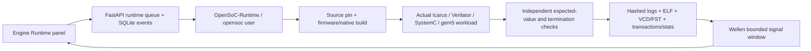

# Runtime pipelines — implemented reference scope

The workbench now launches actual reviewed engine workflows. Original user-source `Analyze RTL` still runs pyslang only. Generic Composer simulation is not enabled by this reference runtime.

| Profile | Implemented stages | Fidelity |
|---|---|---|
| `picorv32_icarus` | source snapshot → RISC-V firmware → Icarus build/run → host arithmetic/MMIO oracle → Wellen | Actual upstream CPU RTL |
| `picorv32_verilator` | source snapshot → RISC-V firmware → Verilator/G++ build/run → host oracle → Wellen | Actual upstream CPU RTL, timing SV testbench |
| `ibex_simple_system` | source/tool check → FuseSoC/Edalize/Verilator → forced firmware rebuild → execution → UART/instruction/FST oracle → Wellen | Actual Ibex small configuration |
| `yosys_netlist` | Yosys synthesis → RTL versus netlist simulation → reset/hold/write oracle → Wellen | Project reference register, not a whole synthesized CPU |
| `systemc_tlm` | G++/SystemC build → synthetic initiator/target → paired transaction/data/timing oracle | TLM memory model, no CPU |
| `systemc_verilated` | Verilator `--sc` + G++/SystemC → TLM initiator to actual RTL register → paired oracle | Blocking adapter, no gem5 CPU |
| `gem5_riscv` | RISC-V workload build → pinned gem5 RISC-V TimingSimpleCPU → program/termination/stats oracle | Syscall-emulation architecture model, not vendor RTL |
| `gem5_tlm_roundtrip` | Same CPU workload → native gem5/SystemC TLM bridges → memory → two CommMonitors / ordered paired trace | Compiled-in SystemC kernel; no RTL peripheral |

Availability is read from actual preparation inventory; functional acceptance is recorded separately in each run. See [latest execution evidence](../test-evidence/runtime/REPORT.md). Future/failed builds must not be represented as successful engine execution.

New API is additive, `/api/v1/runtime/capabilities`, `/runtime/runs`, `/runtime/runs/{id}/events`, artifact downloads, cancellation and waveform windows. Request bodies accept fixed profile/scenario identifiers only. Run and artifact hashes scope waveform selection; unknown IDs fail. Source mapping is explicitly unavailable, while trace names and values are exact. The renderer preserves X/Z and unavailable initial samples, marks truncated windows and does not extend values past an unreturned transition range.

Persistent storage uses a distinct `runtime-run` kind, one active native workflow, a queue bound of four, and monotonic SQLite events. Worker processes enforce command limits and kill Linux process groups on cancel/timeout. A startup marks interrupted records FAILED_INFRA and requests cancellation of their workers. These controls are not full host-filesystem/network sandboxing; uploaded RTL and build scripts remain ineligible for execution.

Preparation uses `npm run runtime:setup`, with a dedicated workspace-backed WSL distro. `npm run runtime:verify` invokes actual HTTP-to-native workflows; application verification remains separate. Native tool notices, exact wheel hashes and local offline Python resolution are retained. Whole-product OS/toolchain/firmware redistribution clearance remains open. [ADR-008](../decisions/ADR-008-engine-runtime.md).
