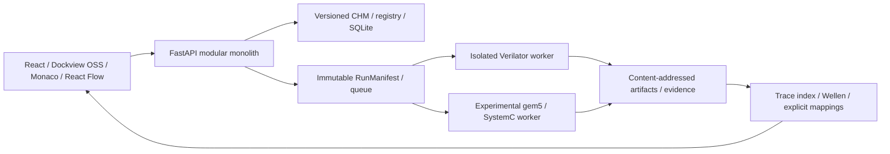

# OpenSoC-Studio V1.0 — kiến trúc M0

> Current runtime: UI/API now launches eight reviewed workflows with actual firmware/native builds, CPU RTL, gem5/SystemC, Yosys and Wellen windows. See [implemented runtime architecture](RUNTIME_PIPELINES.md), [ADR-008](../decisions/ADR-008-engine-runtime.md) and [16-case evidence](../test-evidence/runtime/REPORT.md). The original M0 target diagram below remains historical.

> Native update: fixed PicoRV32/Icarus regression now executes firmware on actual RTL and exposes read-only evidence downloads. See [ADR-007](../decisions/ADR-007-reference-rtl-regression.md) and [results](../test-evidence/real-soc/REPORT.md). This does not close Ibex/gem5/Wellen/sandbox gates.

> Hồ sơ baseline M0. Workbench/API đã được triển khai sau chỉ dẫn tiếp tục của người dùng; xem [trạng thái hiện tại](../implementation/STATUS.md) và ADR-005/006. Các mô tả “chưa có” dưới đây ghi nhận thời điểm baseline, không phải trạng thái hiện tại.

Trạng thái: **PROVISIONAL / M0 PARTIAL**. Repository chưa có ứng dụng GUI/API hoặc simulator được tích hợp. Xem [phạm vi M0](M0_SCOPE.md), [toolchain](TOOLCHAIN_AUDIT.md), [spikes](../reference-platforms/SPIKES.md).

Đây là kiến trúc đích, không phải sơ đồ module đã tồn tại. UI chỉ gửi changeset; CHM sở hữu semantics. Tọa độ layout không quyết định connectivity. Domain model không import UI hoặc concrete vendor provider. Native tool chạy qua worker riêng; API request không compile hoặc chạy RTL.

| Lane | CPU | Kết quả hợp lệ khi đã kiểm chứng | Trạng thái hiện tại |
|---|---|---|---|
| rtl_standalone | Không có | Vectors, handshake, waveform | UNSUPPORTED trên host này |
| rtl_cpu_soc | CPU RTL thật, Ibex trước | Firmware/PC/cycle/MMIO | EXPERIMENTAL ở thiết kế; chưa chạy |
| gem5_arch | CPU model gem5 | Workload/stats theo board profile | EXPERIMENTAL; chưa có board |
| gem5_hybrid | CPU model gem5 + RTL peripheral | MMIO qua bridge có correlation | EXPERIMENTAL; gate B/C chưa đạt |

Không đồng nhất gem5 CPU model với Ibex/Rocket RTL. Không lấy wall-clock hoặc giờ nhận WS làm simulation time. Ticks là decimal string; chuyển đổi fs bằng integer, có epoch và domain. `VERIFIED` phải gắn đúng contract, cấu hình, toolchain và artifact; selection có `EXACT/DERIVED/UNAVAILABLE`, thiếu mapping phải hiển thị rõ.

MVP sau M0: SQLite + filesystem được quản lý, Python 3.11+ (chưa chọn exact interpreter), FastAPI/Pydantic exact pins được audit trước M1. Node 24.22.0 ở chu kỳ này chỉ chạy validator/doctor/audit. Rust Wellen và C++ SystemC là tiến trình riêng, không ép user viết SystemC. AI mặc định OFF; chưa cài SDK/model/cloud.

Import/source staging, archive guards, sandbox quotas, process cancellation, RBAC và trace index là các phần **chưa triển khai**. Vì thế tooling M0 không nhận/chạy RTL người dùng. Runtime tương lai phải chạy unprivileged, nguồn readonly, output giới hạn, network disabled, không host Docker socket.

Để khóa kiến trúc cần A chạy CPU RTL thật, B có kết quả bridge ban đầu, C có protocol test và D có viewer benchmark theo §19. Khi chưa đạt, giữ schemas là draft và không nâng capability thành SUPPORTED.
